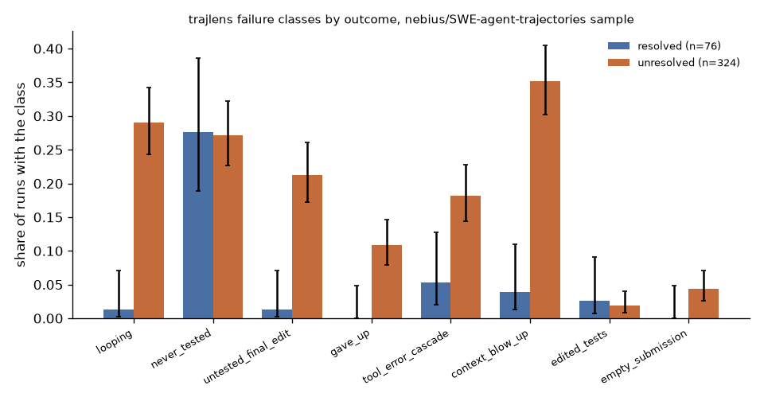

# trajlens

Read coding-agent trajectories from several open formats, measure how the agent behaved, and
label failures with small documented rules that each point at the steps they rest on.

## Why this is hard

A trajectory is a long, loosely structured log: free text, tool calls, shell commands and
their output, interleaved in whatever shape the agent framework chose. Pass or fail on the
task says nothing about how the agent got there. Deciding that an agent looped, never ran the
tests, or gave up means reading every step, matching commands that differ only in whitespace
or a line number, telling an edit-test cycle apart from a stuck agent, and noticing failures
in formats that record no exit codes at all. Doing that by hand does not scale past a handful
of runs; doing it with opaque heuristics makes the labels untrustworthy. trajlens keeps every
rule small, documented, configurable from the command line, and tied to the step ids it used,
so a reader can open the run at that step and check the call.

## Install

```
pip install git+https://github.com/vipul21435/trajlens
```

Python 3.10 or later; no runtime dependencies outside the standard library.

## Quickstart

On three of the fixtures in `tests/fixtures/` (two generic JSONL files and one SWE-agent
`.traj`):

```
$ trajlens analyze tests/fixtures/loop.jsonl tests/fixtures/good.jsonl tests/fixtures/sample.traj --html report.html
loop: 7 steps, 1 edits, 0 test runs, error rate 0.71, first edit 1, first test None, tests after last edit False, patch files 0
  looping: exact repeat of "python -c 'import calc'" across 5 steps [steps 2,3,4,5,6]
  never_tested: 1 edits and no test run [steps 1]
  gave_up: no submit step and empty patch [steps 6]
  tool_error_cascade: 5 consecutive error steps [steps 2,3,4,5,6]
good: 7 steps, 1 edits, 2 test runs, error rate 0.14, first edit 4, first test 3, tests after last edit True, patch files 1
sample: 5 steps, 1 edits, 1 test runs, error rate 0.00, first edit 2, first test 3, tests after last edit True, patch files 1
runs: 3
mean steps: 6.3
mean error rate: 0.286
runs with finding: looping=1, never_tested=1, gave_up=1, tool_error_cascade=1
runs with no finding: 2
```

`--json report.json` writes every metric and finding. `--html report.html` writes one
self-contained page (inline styles, no server, no CDN, no external requests): a summary, the
tool mix, the failure-class table with the rule text, a run table that filters by class, and
per-run step tables in which every evidence step is highlighted and linked from its finding.
The report data is embedded in the page as JSON.

`trajlens show RUN` prints one run step by step: index, `!` for a failed step, `*` for a
step a finding cites, tool class, exit code, observation size and the first line of the
command. On one run of the public sample used in the results below (row 74386 of
nebius/SWE-agent-trajectories, fetched with `scripts/fetch_nebius_sample.py`):

```
$ trajlens show nebius-sample/row74386.json --format chat --width 96
row74386 (chat): 13 steps, resolved False, exit status submitted
  looping: exact repeat of 'edit 350:358 ...' across 5 steps [steps 5,6,7,8,9]
  never_tested: 8 edits and no test run [steps 4,5,6,7,8,9,10,11]
  tool_error_cascade: 6 consecutive error steps [steps 4,5,6,7,8,9]
   0   search   -     317  search_dir "InconsistentPedigreeException"
   1   read     -    3818  open biomedsheets/shortcuts/germline.py
   2   search   -     542  search_file "InconsistentPedigreeException" biomedsheets/shortcuts/ge
   3   read     -    5135  goto 351
   4!* edit     -    3404  edit 350:358
   5!* edit     -    3404  edit 350:358
   6!* edit     -    3404  edit 350:358
   7!* edit     -    3404  edit 350:358
   8!* edit     -    3404  edit 350:358
   9!* edit     -    3404  edit 350:358
  10 * edit     -    5194  edit 350:350
  11 * edit     -    5231  edit 357:357
  12   submit   -       0  submit
```

The agent edited lines 350 to 358 six times in a row, five times with identical text;
SWE-agent rejected each attempt (the failures are inferred from its syntax-error message,
since the format has no exit codes), and the run submitted without ever running code.

Other outputs and switches: `--csv runs.csv` writes one row per run (scalar metrics and a
0/1 column per class) for a spreadsheet or a dataframe; `--group-by model` (or
`source_format`, `exit_status`, `task_id`) repeats the class counts per group, in the text
output and in the HTML report; `--fail-on looping,edited_tests` (or `any`) makes the command
exit with status 1 when any run carries one of the named classes, so a batch of agent runs can
gate a CI job. `trajlens convert RUN... --out DIR` rewrites any supported input as generic
JSONL.

The example script analyses every fixture and writes both reports:

```
uv run python examples/analyze_fixtures.py out/
```

## How it works

### Inputs and the step model

Every adapter produces the same `Trajectory`: a run id, an ordered list of `Step`s, the
final patch, and optional run-level fields (`task_id`, `model`, `exit_status`, `resolved`).
A step holds `thought`, the tool class, the raw action name, `command`, `observation`,
`exit_code`, `timestamp`, `tokens_in` and `tokens_out`; whatever the source format lacks
stays `None`.

| `--format` | input | detected from |
| --- | --- | --- |
| `generic` | one JSONL file per run, documented below | `*.jsonl` |
| `sweagent` | SWE-agent `.traj` (`trajectory` list, or `history` messages), `info.submission` as the patch, `info.model_stats` token totals | `*.traj`, or a JSON object with `trajectory` |
| `minisweagent` | mini-swe-agent `.traj.json` (message list, or object with `messages` and `info`); exit code from `<returncode>` | `*.traj.json`, or role/content message lists |
| `openhands` | OpenHands event list (`action`/`observation` events linked by `cause`), exit code from `extras.exit_code`, ISO timestamps, cumulative token usage turned into per-step counts | a JSON list of events, or an object with `events` |
| `chat` | a model transcript: messages with `role` (`assistant`/`ai` for the agent, `user`/`tool` for observations) and `content` or `text`; the command is the last fenced block of each agent turn, as SWE-agent's thought-action parser takes it | an object whose `trajectory` is a list of `role` messages with no `action` and no `tool_calls`; a bare message list is read as mini-swe-agent, so pass `--format chat` for it |
| `toolcalls` | a function-calling transcript: `assistant` messages with `tool_calls` (`function.name`, `function.arguments`), `tool` replies matched by `tool_call_id`; one step per call; shell exit code from OpenHands' `[Command finished with exit code N]` line, editor replies starting with `ERROR` count as failures | a message list, or an object whose `trajectory` is one, where some message has `tool_calls` |

Generic JSONL: one step per line with any of `thought`, `action`, `command`, `observation`,
`exit_code`, `timestamp` (epoch seconds), `tokens_in`, `tokens_out`, and optionally `tool`
(one of the classes below). A line with `"type": "meta"` carries `run_id`, `task_id`,
`model`, `patch`, `exit_status` and `resolved` (true or false); a line with
`"type": "patch"` carries the final diff.

The `openhands` adapter reads the event-stream serialisation (`event_to_dict` in the OpenHands
source) and has only been tested on a hand-written event list. Published OpenHands runs are
usually distributed as function-calling transcripts instead; those are read with `toolcalls`,
which is what the OpenHands results below use.

### Tool classes

Every step gets one class: `edit`, `test`, `read`, `search`, `shell`, `submit`, `other`.
Known action names decide first (`edit`, `create`, `str_replace_editor`, `open`, `submit`,
OpenHands `edit`/`write`/`read`/`finish`). A shell command is classified by regular
expressions: test runners (`pytest`, `tox`, `go test`, `cargo test`, `npm test`, `jest`,
`mvn test`, ...) and running a test or reproduction script directly (`python reproduce.py`,
`python tests/test_io.py`) are `test`; `sed -i`, `patch`, `git apply` and shell writes
(`cat > f.py << 'EOF'`, `echo x >> f`, `cat << EOF | tee f`, when every command on the first
line is `cat`, `echo`, `printf` or `tee` and one of them writes a file other than /dev/null)
are `edit`; other pagers and `cat` are `read`; here-document bodies are file contents and are
not searched for test runners; `grep`, `find`, `ls` are `search`. Counting `python reproduce.py` as a test
run follows SWE-agent's default instructions, which ask the agent to reproduce the bug with a
script and rerun it after the fix; without it nearly every SWE-agent run would be labelled
`never_tested`.

Agents also check their work with throwaway scripts whose names say nothing
(`python convert.py`). The command alone cannot tell those from any other program, but the
trajectory can: when the agent created the file earlier in the run (`create <path>`,
`write <path>`, or a shell redirect or tee such as `cat > check.py`, in a step of any class), a later `python <that file>`
is reclassified as a test run (`src/trajlens/scripts.py`; `--no-script-tests` turns it off).
This came from reading 10 `never_tested` findings
(`trajlens audit $(ls nebius-sample/row*.json | tail -n 300) --format chat --label never_tested --n 10 --seed 1 --no-script-tests`):
seven runs never executed anything that could check the change, two checked it with scripts
they had written under other names, and one ran `pylint`, the program the issue was about,
which is still not recognised. Over the 400 runs the rule moves 9 runs out of `never_tested`
(21 to 19 resolved, 88 to 81 unresolved).

### Failed steps

A recorded exit code decides whether a step failed. SWE-agent `.traj` files and chat
transcripts record none, so by default (`--infer-errors auto`) a run with no exit codes at
all has its failures read from the observation text: a Python traceback, a line starting
with `SomethingError:` or `SomethingException:`, `command not found`,
`No such file or directory`, a `Usage:` line, and the two messages SWE-agent itself prints
for a rejected edit and for a malformed reply. `always` applies the patterns to every step
without an exit code; `never` turns inference off. The report marks runs whose error count
was inferred (`errors_inferred`).

### Per-run metrics

Steps; tool mix; edits and failed edits; test runs and failed test runs; edits per test run;
step of the first and last edit and test; whether a test ran after the last edit; error steps,
error rate (error steps / steps) and the longest streak of consecutive failed steps; total
observation characters, the largest observation, and observation growth (mean observation
length of the last third of steps divided by the first third); files in the final patch,
which of them are test files (by path: `tests/`, `test_*.py`, `*_test.*`, `*.spec.*`,
`conftest.py`, ...), and which the patch creates; whether a submit step exists; duration from
timestamps; token totals.

### Loops

Commands are normalised (whitespace collapsed, lower-cased). Starting from each step, later
steps whose command matches are gathered while each match is within `--window` [6] steps of
the previous one; a group of at least `--min-repeats` [3] is a loop. Exact loops compare the
normalised strings; near loops compare with difflib's ratio, 2M/T where M is the number of
matched characters and T the total length of both strings, at or above `--near-threshold`
[0.9] against the group's first command, and skip steps already in an exact loop. An edit
between two repeats of a non-edit command ends the group: rerunning the same test after
changing the code is the edit-test cycle, not a loop. Repeated edits are still grouped,
because an edit that keeps failing to apply is exactly the loop to catch.
`--no-edit-reset` turns this off.

A repeat joins a group only if its observation also looks the same: the first 300 characters
of its observation must be at least `--near-threshold` similar (same ratio) to those of the
group's first step. Paging through a file with `scroll_down`, or reading several files under
one long directory, repeats a command but brings new information each time; the same edit
rejected with the same error, or the same search with the same empty answer, does not.
`--loop-any-observation` turns this off.

Both refinements came from reading findings on the real sample below: the edit reset from the
100 tuning rows, the observation check from a first read of 12 held-out `looping` findings
(seed 7), two of which were `scroll_down` paging through a file. For this class the held-out
rows are therefore not untouched. The effect on the `looping` class over all 400 runs
(`trajlens analyze --format chat nebius-sample/row*.json` with the flags shown):

| flags | resolved runs with looping (of 76) | unresolved runs with looping (of 324) |
| --- | --- | --- |
| `--no-edit-reset --loop-any-observation` | 16 | 149 |
| `--loop-any-observation` | 4 | 116 |
| `--no-edit-reset` | 4 | 108 |
| defaults | 1 | 94 |

A hand check of the defaults: 20 `looping` findings drawn at random from the 75 held-out runs
that carry one were read step by step
(`trajlens audit $(ls nebius-sample/row*.json | tail -n 300) --format chat --label looping --n 20 --seed 2026`). 19 were repeats
that brought nothing new: the same edit rejected for the same syntax error up to 24 times,
`find. -name ...` (a typo answered by `command not found`) 262 times, the same file opened or
the same `find_file` issued again and again. The twentieth was a `grep` for one function over
four different directories, each returning nothing; it is a systematic search rather than a
stuck agent, so the near-duplicate rule still over-reaches when commands share a long path.
One reader, no second rater: treat this as a sanity check, not a measured precision.

### Failure classes

Each class is a rule over the metrics; a run can carry several. Defaults in brackets.

| class | rule | evidence step ids |
| --- | --- | --- |
| looping | an exact or near loop of at least `--loop-min-steps` [4] steps | the loop's steps |
| never_tested | at least one edit and no test run | the edit steps |
| untested_final_edit | test runs exist but none after the last edit | last edit, last test |
| gave_up | no submit step, and an empty patch or a failed last step | the last step |
| tool_error_cascade | at least `--cascade-min` [4] consecutive failed steps | the streak |
| context_blow_up | observations reach `--context-chars` [60000] characters in total, or one observation has at least `--blowup-chars` [20000] | the step where the total crosses the limit; the largest observation |
| edited_tests | the final patch modifies or deletes a test file that existed before the run (created test files count only with `--include-new-tests`) | the edit steps aimed at those files: a path argument, or for line-range editors such as SWE-agent's `edit 10:12` the file last opened; none when no edit step names the file (one written by a script, say); the files are named in the detail |
| empty_submission | a submit step and an empty patch | the submit steps |

Why these rules: `never_tested`, `untested_final_edit` and `edited_tests` follow the SWE-bench
setup, where a patch is judged by the repository's own tests and the evaluation harness
applies the task's test patch over the agent's before running them (`swebench/harness` in
github.com/SWE-bench/SWE-bench), so edits to existing test files are at best overwritten and at
worst a sign of making tests pass without fixing the code. `context_blow_up` counts the total of
all observations because an agent framework keeps the history in the prompt, so it is the
total, not the largest single output, that exhausts the context window. The first version used
an observation-growth ratio (threshold 5.0) instead; on the 100 tuning rows none of the 18 runs
the framework stopped for context length had growth above 3.7 or a single observation above
8,400 characters, so that rule missed all of them, and it was replaced. The 60000
default was set by looking at the first 100 rows of the sample (every run stopped for context
had at least 61,065 characters of observations; the most any other run had was 76,830) and is
then checked on the 300 rows held out. These figures come from the `--csv` output of
`trajlens analyze --format chat` on the 100 lowest-offset rows, filtered on `exit_status`.
`gave_up` and `empty_submission` separate a run that stopped from one that submitted nothing.

### Comparing two reports

`trajlens compare A.json B.json` reads two `--json` reports and gives, for every class, the
share of runs carrying it in each and the difference B - A with a 95 % interval. A share's
interval is the Wilson score interval; the difference uses Newcombe's hybrid score interval
(Newcombe, "Interval estimation for the difference between independent proportions:
comparison of eleven methods", Statistics in Medicine 17(8), 873-890, 1998), which combines
the two Wilson intervals (l, u) around the shares pA and pB:

```
d     = pB - pA
lower = d - sqrt((pB - lB)^2 + (uA - pA)^2)
upper = d + sqrt((uB - pB)^2 + (pA - lA)^2)
```

The tests check that the interval contains d, flips sign when A and B are swapped, and covers
the true difference in 93 % to 97.5 % of 2,000 simulated draws (pA = 0.30, pB = 0.45,
nA = 80, nB = 60). Runs are treated as independent samples; when both reports hold the same
tasks run by two agents, a paired method would be tighter, and none is implemented.

## Results on real public data

### SWE-agent: 400 runs from nebius/SWE-agent-trajectories

Data: 400 runs drawn from
[nebius/SWE-agent-trajectories](https://huggingface.co/datasets/nebius/SWE-agent-trajectories)
(80,036 SWE-agent runs on GitHub issues, with the final patch, the framework's exit status,
and whether the task's tests passed on the patch; licence CC BY 4.0, checked on the dataset
page, which also asks that the Llama-generated outputs be used under the Llama 3.1 licence and
that the licence of each source repository be respected). The sample is 100 random offsets with seed 0, four consecutive rows each, read through
the public datasets-server rows endpoint; the test log column is dropped. 76 of the 400 runs
are resolved. No row is committed to this repository; the script downloads them (26 MB).
The 100 rows with the lowest offsets are the ones the defaults were looked at on ("tuning");
the other 300 are held out.

```
uv run python scripts/fetch_nebius_sample.py --out nebius-sample
uv run --with matplotlib python scripts/real_data_report.py nebius-sample --chart docs/images/classes_by_outcome.png
trajlens analyze --format chat nebius-sample/row*.json --json report.json --html report.html
```

The last command, on all 400 files including the 9 MB HTML report, took 2.9 to 3.0 s wall
clock over four runs (`/usr/bin/time -p`, one laptop, 1-minute load average 2.4 to 2.6); the
time depends on the machine and its load, so treat it as a rough scale, not a benchmark.
The tables are the output of the second command.

Behaviour over all 400 runs, default options:

| metric | value |
| --- | --- |
| runs | 400 |
| mean steps | 25.2 |
| mean edits | 8.5 |
| mean failed edits (inferred) | 3.3 |
| mean test runs | 3.1 |
| mean error rate (inferred) | 0.195 |
| mean first edit step (runs with an edit) | 2.3 |
| mean first test step (runs with a test) | 4.7 |
| runs with a loop | 120 |
| runs testing after the last edit | 217 |
| runs submitted | 267 |
| runs with an empty patch | 49 |
| runs with no finding | 144 |
| failed steps by tool class | 2920: edit 1315, test 706, search 575, shell 292, read 32 |
| tool mix (share of steps) | edit 33.8%, test 12.3%, read 17.9%, search 22.5%, shell 10.8%, submit 2.7% |

"Runs with a loop" counts any loop of three or more repeats; the `looping` class below needs
four. A third of all steps are edits, 3.3 of the 8.5 edits per run failed, and edits are 1,315
of the 2,920 failed steps: in this data the editor rejecting an edit is the most common way
a step fails.

Share of runs carrying each class, resolved against unresolved (95 % Wilson intervals):

| class | resolved runs (n=76) | unresolved runs (n=324) |
| --- | --- | --- |
| looping | 1/76 = 1.3% [0.2%, 7.1%] | 94/324 = 29.0% [24.3%, 34.2%] |
| never_tested | 19/76 = 25.0% [16.6%, 35.8%] | 81/324 = 25.0% [20.6%, 30.0%] |
| untested_final_edit | 1/76 = 1.3% [0.2%, 7.1%] | 70/324 = 21.6% [17.5%, 26.4%] |
| gave_up | 0/76 = 0.0% [0.0%, 4.8%] | 35/324 = 10.8% [7.9%, 14.7%] |
| tool_error_cascade | 4/76 = 5.3% [2.1%, 12.8%] | 59/324 = 18.2% [14.4%, 22.8%] |
| context_blow_up | 3/76 = 3.9% [1.4%, 11.0%] | 114/324 = 35.2% [30.2%, 40.5%] |
| edited_tests | 2/76 = 2.6% [0.7%, 9.1%] | 6/324 = 1.9% [0.9%, 4.0%] |
| empty_submission | 0/76 = 0.0% [0.0%, 4.8%] | 14/324 = 4.3% [2.6%, 7.1%] |
| (no finding) | 49/76 = 64.5% [53.3%, 74.3%] | 95/324 = 29.3% [24.6%, 34.5%] |



On the 300 held-out rows alone (52 resolved, 248 unresolved) the pattern is the same:
looping 1.9 % against 29.8 %, untested_final_edit 0.0 % against 21.0 %, context_blow_up
3.8 % against 37.5 %, no finding 65.4 % against 27.0 %.

Agreement of two rules with the exit status the framework recorded (the rules never read it):

| rule vs status | rows | tp | fp | fn | tn | precision | recall |
| --- | --- | --- | --- | --- | --- | --- | --- |
| context_blow_up vs exit_context | tuning | 18 | 4 | 0 | 78 | 0.82 | 1.00 |
| gave_up vs not submitted | tuning | 10 | 0 | 0 | 90 | 1.00 | 1.00 |
| context_blow_up vs exit_context | held-out | 86 | 9 | 11 | 194 | 0.91 | 0.89 |
| gave_up vs not submitted | held-out | 23 | 2 | 0 | 275 | 0.92 | 1.00 |

Grouped by the exit status the framework recorded
(`trajlens analyze --format chat nebius-sample/row*.json --group-by exit_status`, runs carrying
each class):

| exit status | runs | resolved | looping | untested_final_edit | gave_up | tool_error_cascade | context_blow_up | empty_submission |
| --- | --- | --- | --- | --- | --- | --- | --- | --- |
| submitted | 258 | 28.7% | 11 | 16 | 0 | 17 | 11 | 5 |
| submitted (exit_context) | 100 | 2.0% | 69 | 45 | 2 | 34 | 92 | 0 |
| early_exit | 18 | 0.0% | 6 | 10 | 18 | 5 | 2 | 0 |
| exit_context | 15 | 0.0% | 9 | 0 | 15 | 7 | 12 | 0 |
| submitted_no_patch | 9 | 0.0% | 0 | 0 | 0 | 0 | 0 | 9 |

69 of the 100 runs that were cut off for context length and then auto-submitted contain a
loop of four or more steps, against 11 of the 258 runs that submitted on their own. That is
consistent with repeated actions filling the context, though counts like these cannot
separate cause from effect.

What this says and does not say. `looping`, `untested_final_edit`, `context_blow_up` and
`gave_up` are far more common in unresolved runs; `never_tested` is not (25.0 % against
25.0 %), so on this data an agent that edits without running anything is no less likely to
pass, and the class describes process, not outcome. `edited_tests` is rare in both groups.
These are associations in one dataset produced by one agent scaffold with three Llama-based
models (360 of the 400 runs come from the 70B one), not causes, and resolved runs are a
minority (19 %), so their intervals are wide.

### OpenHands: 60 runs from nebius/SWE-rebench-openhands-trajectories

Data: 60 runs from
[nebius/SWE-rebench-openhands-trajectories](https://huggingface.co/datasets/nebius/SWE-rebench-openhands-trajectories)
(67,074 OpenHands function-calling runs on SWE-rebench issues, one model; licence CC BY 4.0,
checked on the dataset page and its LICENSE file), 15 random offsets with seed 0, four rows
each, tool schemas dropped (15 MB). 29 of the 60 runs are resolved. No threshold was looked
at on this sample before the run below.

```
uv run python scripts/fetch_nebius_sample.py --dataset openhands --blocks 15 --out oh-sample
uv run python scripts/real_data_report.py oh-sample --format toolcalls --tuning 0
trajlens analyze --format toolcalls oh-sample/row*.json --group-by exit_status
```

| metric | value |
| --- | --- |
| runs | 60 |
| mean steps | 62.0 |
| mean edits | 10.4 |
| mean failed edits | 0.4 |
| mean test runs | 15.0 |
| mean error rate | 0.093 |
| mean first edit step (runs with an edit) | 24.8 |
| mean first test step (runs with a test) | 7.9 |
| runs with a loop | 20 |
| runs testing after the last edit | 56 |
| runs submitted | 53 |
| runs with an empty patch | 0 |
| runs with no finding | 0 |
| failed steps by tool class | 354: test 191, search 82, shell 36, edit 24, read 21 |
| tool mix (share of steps) | edit 16.8%, test 24.3%, read 25.6%, search 14.8%, shell 11.6%, submit 1.4%, other 5.4% |

Shell exit codes here are recorded by OpenHands and editor failures come from its `ERROR`
replies; nothing is inferred from free text. This agent behaves very differently from the
SWE-agent runs above: it runs a test at step 7.9 on average and edits only at step 24.8, and
56 of the 60 runs test after their last edit. Class counts (runs carrying the class, resolved
of 29 / unresolved of 31): looping 5 / 3, untested_final_edit 0 / 4, edited_tests 2 / 1,
never_tested, gave_up, tool_error_cascade and empty_submission 0 / 0. Only
untested_final_edit leans towards unresolved runs, and 4 runs are too few to read much into.

Two rules do not transfer as they stand:

- `context_blow_up` fires on all 60 runs. The median run shows 150,582 characters of
  observations (25,436 in the SWE-agent sample) and its largest single observation is 30,047
  characters (4,496), so the 60,000-character default chosen on SWE-agent data means nothing
  for this scaffold; `--context-chars` has to be set per framework. (Medians of the
  `observation_chars` and `largest_observation_chars` columns of `trajlens analyze --csv` on
  each sample, rounded to whole characters.)
- `gave_up` catches none of the 7 runs that did not end with the finish action (6 stopped at
  the 100-iteration limit, 1 by the framework's own stuck-in-a-loop detector): the dataset's
  patch field is never empty in this sample, even for runs that stopped early, and none of
  those runs ended on a failed step. Hitting an iteration limit is not covered by any class.

The one run OpenHands stopped as stuck in a loop is labelled `looping` by trajlens too.

### The two samples side by side

```
$ trajlens analyze --format chat nebius-sample/row*.json --json swe.json
$ trajlens analyze --format toolcalls oh-sample/row*.json --json oh.json
$ trajlens compare swe.json oh.json --names swe-agent openhands
class                       swe-agent        openhands   openhands - swe-agent [95% interval]
looping                 95/400  23.8%      8/60  13.3%    -10.4% [ -18.2%,   +1.1%]
never_tested           100/400  25.0%      0/60   0.0%    -25.0% [ -29.5%,  -17.8%] *
untested_final_edit     71/400  17.8%      4/60   6.7%    -11.1% [ -16.8%,   -1.2%] *
gave_up                 35/400   8.8%      0/60   0.0%     -8.8% [ -11.9%,   -2.3%] *
tool_error_cascade      63/400  15.8%      0/60   0.0%    -15.8% [ -19.6%,   -8.9%] *
context_blow_up        117/400  29.2%     60/60 100.0%    +70.8% [ +63.2%,  +75.0%] *
edited_tests             8/400   2.0%      3/60   5.0%     +3.0% [  -0.8%,  +11.8%]
empty_submission        14/400   3.5%      0/60   0.0%     -3.5% [  -5.8%,   +2.7%]
* interval excludes zero
```

This is not a controlled comparison: the scaffolds, models, task sets and the way failures
are recorded all differ, and the `context_blow_up` row only shows that the default threshold
does not fit the OpenHands runs. What it does show is the behaviour gap the per-sample tables
suggest: the OpenHands runs always tested something and never hit a streak of four failed
steps, where a quarter of the SWE-agent runs never ran a check and one in six had such a
streak.

### Other formats

Smaller checks, all from the MIT-licensed SWE-agent and mini-swe-agent repositories (licences
read from the LICENSE files on GitHub):

```
trajlens analyze swe-agent-trajectories/*.traj
```

on the 22 `.traj` files under `trajectories/demonstrations/` and `tests/test_data/trajectories/`
of github.com/SWE-agent/SWE-agent (9 of them capture-the-flag demonstrations, not code
fixes): 22 runs, mean 10.5 steps, mean error rate 0.057 (inferred), findings looping 1,
never_tested 5, context_blow_up 1, edited_tests 2, empty_submission 1, no finding 15. The two
mini-swe-agent sample files under `tests/test_data/` of github.com/SWE-agent/mini-swe-agent
parse to 10 and 2 steps; both are labelled empty_submission because they are plain message
lists, a form that carries no submission field, so the patch is empty.

## Limitations

- Tool classes come from action names and regular expressions over the command. A test run
  hidden inside a shell script, an editor under an unusual name, or a `python -c` one-liner
  that exercises the fix is missed, as is running the program the issue is about (`pylint` in
  one audited run); `python reproduce.py`, or any script the agent wrote, counts as a test even
  when it checks nothing.
- Error inference reads observation text with a fixed list of patterns. A failing step that
  prints none of them is a success to trajlens, and a step that prints an old traceback it
  merely displayed (for example `cat`-ing a log) is a failure.
- Test-file detection is by path only.
- A non-zero exit code is a failure even when it is the command's normal answer: `grep` with
  no match exits 1. Of the 82 failed search steps in the OpenHands sample, 72 are `grep`
  commands that exited 1 with no output (counted with a few lines of Python over the loaded
  steps: tool `search`, exit code 1, `grep` in the command, nothing before OpenHands' status
  lines).
- No class for running out of budget (iteration, cost or time limit); such runs are labelled
  only by what they did before the limit.
- Near-duplicate detection compares strings, so two commands that do the same thing but look
  different are not matched, and two different edits to neighbouring lines can be.
- The `context_blow_up` default was chosen on 100 rows of one dataset with one scaffold; other
  frameworks truncate observations or summarise history differently, so `--context-chars`
  should be set per framework. Characters, not tokens, are counted; no tokenizer is used.
- The `openhands` event-stream adapter has only been run on a synthetic event list; the
  public OpenHands runs analysed here are function-calling transcripts read by `toolcalls`.
  The mini-swe-agent adapter has only been run on the two sample files in that repository.
- The real-data samples are small (400 and 60 runs) and each comes from one dataset
  publisher; the OpenHands sample has one model.
- `edited_tests` sees only the final patch, not test files edited and later reverted.
- No per-step outcome model: a run's resolution is read from the input when present, never
  computed. The rules label behaviour; they do not predict success.

## Related tools

- [graderguard](https://github.com/vipul21435/graderguard): audit graders for reward hacking
  and flakiness, the grader-side view of what `edited_tests` flags in a run.
- [taskledger](https://github.com/vipul21435/taskledger): schema validation and lint rules for
  benchmark-task bundles.
- [datasieve](https://github.com/vipul21435/datasieve): validate and deduplicate SFT and
  preference data, for when trajectories become training data.
- [reporewind](https://github.com/vipul21435/reporewind): resolve Python fix commits into
  source and test patches.

## Licence

MIT. See LICENSE.

Built by Vipul Raj Jha · https://vipul21435.github.io
